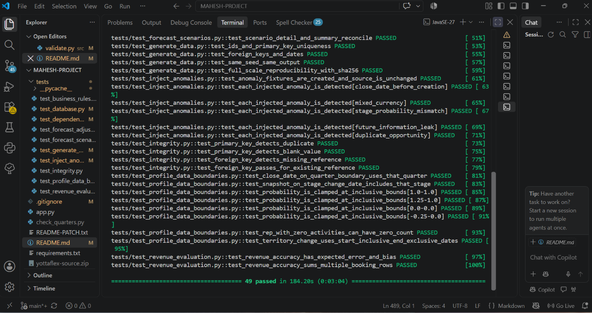
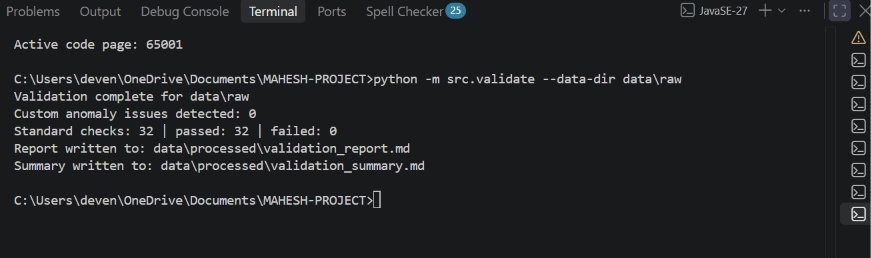
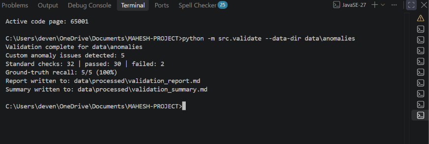

# YottaFlex Forecast — Sales Forecasting Proof of Concept

A reproducible Python proof of concept (POC) for synthetic sales-pipeline management, weighted revenue forecasting, scenario analysis, historical forecast evaluation, and data-quality validation.

**Important: All records in this project are synthetic.** Names, companies, opportunities, activities, amounts, bookings, and territories are generated examples. They do not represent real customers, employees, or actual YottaFlex sales performance.

---

## 1. What Is a Proof of Concept?

A proof of concept is a working experiment designed to answer a focused question:

*Can this idea work with practical data, documented assumptions, and clear business rules?*

A POC is not a finished company-wide product. It helps stakeholders review an approach, test assumptions, identify gaps, and decide what should be developed next.

This project is a local Python POC. It generates synthetic sales data, calculates forecasts, evaluates historical results, validates business rules, and stores data in CSV, SQLite, and JSON formats.

## 2. The Business Problem

A sales team may have many open opportunities at different stages. Simply adding the full value of every deal can overstate the revenue the business should reasonably expect.

For example, a $20,000 opportunity in an early sales stage should not be treated the same as a $20,000 opportunity close to being won.

A weighted forecast addresses this by multiplying each opportunity's amount by the probability associated with its current sales stage.

The resulting expected revenue can be grouped by:

- Quarter
- Territory
- Sales stage

The project also evaluates historical forecasts against synthetic bookings and checks whether the information used in an earlier forecast was actually available on its snapshot date.

This helps identify future-information leakage, which can make historical forecasts appear more accurate than they really were.

## 3. What Was Built?

The project includes:

- A deterministic synthetic data generator with **starter** and **full** dataset sizes.
- Synthetic reference data for territories, sales stages, sales representatives, and accounts.
- Opportunity, stage-history, activity, quota, booking, and forecast-snapshot records.
- A baseline weighted-pipeline forecast and a separate adjusted forecast.
- Three deterministic what-if scenarios: pessimistic, baseline, and optimistic.
- Historical forecast evaluation using recorded synthetic bookings.
- Primary-key, foreign-key, enum, date, lifecycle, reconciliation, duplicate, and snapshot-time validation.
- Five labelled data anomalies for testing validation rules.
- A SQLite database, SQL seed file, and JSON exports for all 11 tables.
- An optional local Streamlit viewing page in `app.py`.
- A Markdown validation summary with category-wise pass/fail counts.
- A full-scale reproducibility test comparing row counts and SHA-256 checksums across two independent runs.

### Technology Stack

| Area | Technology |
|---|---|
| Programming language | Python |
| Data processing | Pandas |
| Data storage | CSV, SQLite |
| Data export | JSON |
| Forecast calculations | Python |
| Validation | Custom Python checks |
| Automated testing | Pytest |
| Optional interface | Streamlit |
| Reproducibility | Fixed seed and SHA-256 |
| Version control | Git and GitHub |

## 4. Data Volumes and Reproducibility

The full dataset uses a fixed random seed (`20261022`) and generates 11 CSV tables.

### Full Dataset Size

| Table | Full-size rows |
|---|---:|
| Territory | 4 |
| Stage | 6 |
| Sales representative | 2,000 |
| Account | 2,000 |
| Rep-territory assignment | 2,400 |
| Opportunity | 20,000 |
| Stage history | 81,428 |
| Activity | 98,030 |
| Quota | 16,000 |
| Historical booking | 2,690 |
| Forecast snapshot | 93,043 |
| **Total** | **317,601** |

The forecast snapshot table contains historical views of opportunities.

The full run produces 93,043 snapshot rows. Scenario generation creates one detail row per snapshot row for each of the three scenarios, resulting in 279,129 scenario-detail rows.

### Fixed Seed

The generator uses the fixed seed:

```text
20261022
```

The seed is defined in `src/generate_data.py` as `SEED`.

The generator CLI currently uses this constant internally. It does not expose a separate `--seed` command-line argument.

### Generate the Full Dataset

```bash
python -m src.generate_data --scale full --out data/raw
```

For a smaller, faster dataset:

```bash
python -m src.generate_data --scale starter --out data/raw
```

### Manifest and File Checksums

The generator creates a manifest containing row counts, file sizes, and SHA-256 checksums.

Manifest locations:

- Clean dataset: `data/raw/manifest.json`
- Anomaly dataset: `data/anomalies/manifest.json`

Create and verify the clean dataset manifest:

```bash
python -m src.manifest --data-dir data/raw
python -m src.manifest --data-dir data/raw --verify
```

Generate the anomaly dataset and its manifest:

```bash
python -m src.inject_anomalies
```

Regenerating the same dataset with the same code, scale, and seed is intended to produce identical CSV contents.

### Reproducibility Verification

The automated reproducibility tests verify that:

- Starter-scale generation produces identical DataFrames and CSV contents for the same seed.
- Full-scale generation runs twice using seed `20261022`.
- All 11 generated tables have matching row counts across both full-scale runs.
- SHA-256 checksums match for every corresponding CSV file.

The full-scale reproducibility test uses temporary directories and does not overwrite `data/raw`.

## 5. How the Forecast Works

### Stage Probabilities

The POC uses fixed example probabilities for each sales stage.

| Sales stage | Probability |
|---|---:|
| Prospecting | 10% |
| Qualification | 25% |
| Proposal | 50% |
| Negotiation | 80% |
| Closed Won | 100% |
| Closed Lost | 0% |

These are configured example assumptions, not probabilities learned from a machine-learning model.

### Forecast Formula

**Weighted expected revenue = Opportunity amount × Stage probability**

The forecast adds the weighted opportunity values for the selected quarter, territory, and stage.

### Worked Example: $21,500 Weighted Revenue

| Opportunity | Amount | Stage | Calculation | Expected revenue |
|---|---:|---|---:|---:|
| A | $10,000 | Proposal (50%) | $10,000 × 0.50 | $5,000 |
| B | $20,000 | Negotiation (80%) | $20,000 × 0.80 | $16,000 |
| C | $5,000 | Prospecting (10%) | $5,000 × 0.10 | $500 |
| **Total** | **$35,000** | | | **$21,500** |

The raw pipeline is $35,000. After applying the stage probabilities, the weighted pipeline is **$21,500**.

## 6. Scenario Analysis

The project supports three deterministic what-if scenarios.

They retain the same opportunities, amounts, and snapshot dates while changing the probability and revenue assumptions.

| Scenario | Calculation rule |
|---|---|
| Pessimistic | Baseline probability × 0.75; then expected revenue × 0.85 |
| Baseline | Original stage probability and original amount |
| Optimistic | Baseline probability × 1.20, capped at 100%; amount unchanged |

For the $21,500 example:

- **Pessimistic:** $13,706.25
- **Baseline:** $21,500.00
- **Optimistic:** $25,800.00

These are illustrative scenario outputs, not guarantees, statistical ranges, or confidence intervals.

### Verified Full-Dataset Scenario Totals

| Scenario | Full-dataset scenario total |
|---|---:|
| Pessimistic | $380,921,181.86 |
| Baseline | $597,523,425.66 |
| Optimistic | $717,028,101.60 |

## 7. Accuracy and Data-Quality Checks

The project performs standard validation checks and separate custom anomaly detection.

### Standard Validation Checks

The validator runs 32 standard checks.

| Category | Number of checks |
|---|---:|
| Primary-key checks | 11 |
| Foreign-key checks | 15 |
| Business-rule checks | 6 |
| **Total** | **32** |

The checks cover:

- Primary-key uniqueness and required IDs.
- Foreign-key references between related tables.
- Allowed enum values.
- Valid date ordering.
- Valid sales-stage lifecycle transitions.
- Weighted-pipeline detail-to-summary reconciliation.
- Snapshot-time consistency and future-information leakage checks.
- Duplicate opportunities within the same snapshot.

### Validation Reports

Running the validator generates two reports in `data/processed/`.

| File | Purpose |
|---|---|
| `validation_report.md` | Detailed check summaries, detected issues, and optional ground-truth comparison |
| `validation_summary.md` | Category-wise total, passed, and failed counts, overall status, and custom anomaly counts |

The summary reports standard validation checks separately from custom anomaly detections.

Run clean-data validation:

```bash
python -m src.validate --data-dir data/raw
```

Expected clean-dataset result:

- 11 primary-key checks passed.
- 15 foreign-key checks passed.
- 6 business-rule checks passed.
- **32 total standard checks passed, 0 failed.**
- Zero custom anomaly issues.

### Historical Forecast Evaluation

The evaluation compares historical expected revenue with synthetic booked revenue for opportunities that later closed.

It reports:

- Brier scores.
- Weighted Absolute Percentage Error (WAPE).
- Signed bias.
- Results by time-to-close horizon.
- Results by business segment.

A verified run evaluated 11,931 opportunities.

| Model | Brier score |
|---|---:|
| Baseline | 0.457913 |
| Adjusted | 0.176031 |

For Brier score, lower is better.

These results describe this synthetic dataset and this specific run only. They do not establish real-world forecasting accuracy.

The full-run WAPE values are still high (roughly 140%–144% for the adjusted model across the overall horizon groups). Therefore, the adjusted model should not be presented as production-ready or highly accurate.

## 8. The Five Injected Anomalies

The anomaly generator copies the clean CSVs to `data/anomalies/` and deliberately introduces five labelled problems.

It does not modify `data/raw/`.

| Anomaly | What it means |
|---|---|
| Close date before creation | An opportunity is shown as closed before it was created. |
| Mixed currency | A EUR opportunity appears in a dataset that expects USD. |
| Stage-probability mismatch | A snapshot probability does not match the configured probability for its stage. |
| Future-information leak | A snapshot uses a stage that was only recorded after the snapshot date. |
| Duplicate opportunity | The same opportunity appears more than once in a snapshot. |

The validator detected all five labelled anomalies in the verified run:

**5 out of 5 detected — 100% ground-truth recall.**

Ground truth is used only after the validator has produced its detections. It is not used as an input to the detection rules.

The anomaly validation command intentionally returns exit code `1` when it finds issues. That is expected for the deliberately corrupted dataset.

The clean-data validation command should return exit code `0`.

Custom anomaly detections are reported separately from the 32 standard validation checks.

## 9. Project Structure

```text
yottaflex-forecast/
├── app.py                         # Optional local Streamlit prototype
├── data/
│   ├── raw/                       # Clean synthetic source CSVs + manifest
│   ├── anomalies/                 # Corrupted copies + ground truth + manifest
│   └── processed/                 # Generated reports and outputs
│       ├── validation_report.md
│       └── validation_summary.md
├── docs/
│   ├── assumptions.md             # Business and calculation assumptions
│   ├── data_dictionary.md         # Field descriptions
│   ├── schema.md                  # Table relationships and schema notes
│   └── screenshots/
│       ├── test-results.png
│       ├── clean-validation.png
│       └── anomaly-detection.png
├── src/
│   ├── generate_data.py            # Starter/full synthetic data generator
│   ├── manifest.py                 # Create and verify CSV manifest
│   ├── forecast.py                 # Baseline and adjusted forecast
│   ├── scenarios.py                # Three what-if scenarios
│   ├── evaluate.py                 # Historical forecast evaluation
│   ├── check_integrity.py          # Primary-key and foreign-key checks
│   ├── check_business_rules.py     # Business-rule checks
│   ├── inject_anomalies.py         # Create five labelled anomalies
│   ├── validate.py                 # Run checks and write validation reports
│   ├── database.py                 # Build SQLite database and seed SQL
│   ├── export_json.py              # Export SQLite tables to JSON
│   └── profile_data.py             # Distribution profiling report
├── tests/                          # Automated tests
├── requirements.txt
├── .gitignore
└── README.md
```

## 10. Run the Project from a Clean Clone

### Requirements

- Python **3.11 or newer**
- Git
- Internet access for the initial installation of Python packages

### Clone the Repository

```bash
git clone https://github.com/mahesh001-sys/yottaflex-forecast.git
cd yottaflex-forecast
```

### Step 1 — Create and Activate a Virtual Environment

**Windows Command Prompt:**

```cmd
py -m venv .venv
.venv\Scripts\activate
```

**Windows PowerShell:**

```powershell
py -m venv .venv
.\.venv\Scripts\Activate.ps1
```

**macOS / Linux:**

```bash
python3 -m venv .venv
source .venv/bin/activate
```

### Step 2 — Install Packages

Run after activating the virtual environment:

```bash
python -m pip install -r requirements.txt
```

### Step 3 — Generate the Full Synthetic Dataset

```bash
python -m src.generate_data --scale full --out data/raw
```

The full generator uses seed `20261022`.

For a smaller, faster dataset, use `--scale starter` instead of `--scale full`.

### Step 4 — Create and Verify the Manifest

```bash
python -m src.manifest --data-dir data/raw
python -m src.manifest --data-dir data/raw --verify
```

### Step 5 — Build Forecasts and Scenarios

```bash
python -m src.forecast --raw-dir data/raw --processed-dir data/processed
python -m src.scenarios --processed-dir data/processed
```

### Step 6 — Evaluate Historical Forecasts

```bash
python -m src.evaluate
```

### Step 7 — Run Clean-Data Checks

```bash
python -m src.check_integrity --data-dir data/raw
python -m src.check_business_rules --data-dir data/raw
python -m src.validate --data-dir data/raw
```

The clean-data validation should report:

- 32 passed standard checks.
- Zero failed standard checks.
- Zero custom anomaly issues.
- Successful exit status.

Generated summary:

```text
data/processed/validation_summary.md
```

Detailed report:

```text
data/processed/validation_report.md
```

### Step 8 — Inject and Validate the Five Anomalies

```bash
python -m src.inject_anomalies
python -m src.validate --data-dir data/anomalies
```

The second command is expected to report five custom anomaly issues and `5/5 (100%)` ground-truth recall.

It returns exit code `1` because it has correctly detected deliberate data problems. This is not a pipeline failure.

The anomaly validation also generates or updates:

```text
data/processed/validation_summary.md
data/processed/validation_report.md
```

These reports describe the most recently validated dataset.

### Step 9 — Build the SQLite Database and JSON Exports

```bash
python -m src.database --data-dir data/raw --output-dir data/processed
python -m src.export_json --db-path data/processed/yottaflex.db --output-dir data/processed/json
```

The database command also creates `data/processed/seed.sql`.

### Step 10 — Run the Complete Automated Test Suite

```bash
python -m pytest tests/ -v
```

The full-scale reproducibility test generates the dataset twice in temporary directories and compares row counts and SHA-256 checksums. It may take a few minutes.

The database tests create the SQLite database and JSON exports automatically if those generated files are missing. You can therefore run pytest on a clean clone without first running the database commands.

### Optional — Open the Local Streamlit Prototype

After generating the forecast outputs:

```bash
python -m streamlit run app.py
```

This opens the local prototype in a browser. It is not a hosted service or production dashboard.

## 11. Verified Results for This Version

The verified full-size run completed with:

| Verification area | Result |
|---|---|
| Synthetic source data | 317,601 rows across 11 CSV tables |
| Forecast snapshots | 93,043 rows |
| Scenario detail records | 279,129 rows |
| Scenario summary records | 384 rows |
| Historical accuracy results | 18,778 rows |
| Primary-key checks | 11 passed |
| Foreign-key checks | 15 passed |
| Business-rule checks | 6 passed |
| Standard validation checks | 32 passed, 0 failed |
| Clean dataset anomaly issues | 0 |
| Injected anomalies detected | 5/5 |
| Ground-truth recall | 100% |
| SQLite foreign-key check | 0 violations |
| CSV, SQLite, and JSON | Row counts matched for all 11 tables |
| SQL weighted pipeline totals | Matched independent pandas calculation by territory |
| Automated test suite | 49 passed |
| Full-scale reproducibility | SHA-256 comparison passed across all 11 tables |

These results apply to the code, seed, and synthetic dataset used for this verification. They may change if the generator, assumptions, or seed changes.

## 12. Test Results and Validation Evidence

The project was verified using automated tests, clean-dataset validation, and deliberately injected anomalies.

The following screenshots provide terminal evidence from the verified runs.

### 12.1 Automated Test Suite

**49 automated tests passed**, including the full-scale reproducibility test.



### 12.2 Clean Dataset Validation

All **32 standard validation checks passed**, with zero failed checks and zero custom anomaly issues.



### 12.3 Anomaly Detection

All five deliberately injected anomalies were detected, achieving **100% ground-truth recall**.



### Evidence Summary

| Test | Verified result |
|---|---:|
| Automated tests | 49 passed |
| Primary-key validation | 11/11 passed |
| Foreign-key validation | 15/15 passed |
| Business-rule validation | 6/6 passed |
| Clean dataset custom anomaly issues | 0 |
| Anomaly detection | 5/5 detected |
| Full-scale reproducibility | SHA-256 matched across 11 tables |

## 13. What Is Not Built

This is a proof of concept, not a finished forecasting product.

It does **not** include:

- A production-ready dashboard. The included `app.py` is only a small local Streamlit prototype.
- A REST API or backend service for other applications.
- A trained machine-learning forecasting model.
- Probabilities learned from historical company outcomes; stage probabilities are fixed example assumptions.
- Statistical confidence intervals or calibrated uncertainty bands.
- Production authentication, user roles, deployment, monitoring, or live CRM integration.
- Real customer data or a connection to a real sales system.

## 14. Sensible Next Steps

1. Review the synthetic assumptions with sales and finance stakeholders.
2. Replace synthetic inputs only with approved, properly governed business data.
3. Add a documented source for stage probabilities and compare alternative calibration methods.
4. Investigate the high WAPE values and forecast bias before making accuracy claims.
5. Add a production data-ingestion process, API, access controls, and monitoring only if the POC results justify them.
6. Treat any machine-learning model or confidence interval as a separate future experiment that must be evaluated against a time-based holdout.

## 15. Data-Use Note

**All data in this repository is synthetic and generated for demonstration and testing.**

Do not interpret the sample companies, people, opportunities, activities, quotas, bookings, or forecast amounts as real business records or actual YottaFlex performance.
